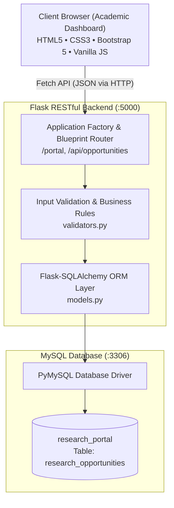

# University Research Opportunity Portal

**Assignment:** Assignment No. 1  
**Course:** Software Development / Web Technologies  
**Degree Program:** BS Computer Science  

---

## Student Information

- **Student Name:** Arslan Tariq
- **Roll Number:** 24P-0610
- **Class / Section:** CS-5C
- **GitHub Username:** [arslantariq364](https://github.com/arslantariq364)

---

## Project Overview

In academic institutions, undergraduate and graduate students frequently encounter significant difficulty finding research openings, laboratory assistantships, and funded project vacancies. Information about these high-impact opportunities is typically fragmented across unstructured faculty email threads, student WhatsApp groups, department corridors, and bulletin noticeboards. As a consequence, students miss vital research deadlines, and faculty supervisors struggle to recruit qualified research assistants matching specialized technical skill requirements.

The **University Research Opportunity Portal** is a production-grade, full-stack academic web platform designed to centralize and streamline research opportunity management. It provides faculty members with a dedicated, intuitive management system to publish, track, edit, and close research openings, while offering students a real-time, searchable, and responsive gateway to discover faculty projects aligned with their technical skills and academic interests.

---

## Key Features

1. **Create Opportunities (POST):**
   - Modal-driven posting form capturing project title, faculty lead, department, research area, required skills, positions available, application deadline, and posting status.
   - Comprehensive client-side and server-side validation ensuring valid positive position counts and strict `YYYY-MM-DD` date formatting.

2. **View & Explore Opportunities (GET):**
   - Fluid 3-column responsive card grid featuring academic department badges, faculty supervisor avatars, skills chips, position counters, and deadline countdowns.
   - Deep-dive detail modal displaying comprehensive project scope, laboratory commitments, and required competencies.

3. **Update Opportunities (PUT):**
   - Modal-based editing interface supporting full and partial field updates with real-time reactive card refresh upon submission.

4. **Close & Reopen Applications:**
   - One-click status toggling (`Open` $\leftrightarrow$ `Closed`) allowing faculty supervisors to immediately close filled positions and archive listings without deleting them.

5. **Delete Opportunities (DELETE):**
   - Safe removal workflow featuring an interactive confirmation modal to prevent accidental data loss.

6. **Real-Time Search & Multi-Criteria Filtering:**
   - Instant search across project titles, faculty leads, and technical skills.
   - Department and research area dropdown filters dynamically populated from live database listings.
   - Segmented status pill controls (`All`, `Open`, `Closed`) with instant count feedback.

7. **Live Real-Time Dashboard Statistics:**
   - 4 evenly distributed metric cards: **Total Listings**, **Active/Open Listings**, **Closed Archive**, and **Open Positions**.
   - Every metric is dynamically calculated from actual REST API payloads (zero hardcoded numbers).

8. **Enterprise Error Handling & User Feedback:**
   - Animated non-blocking toast notifications for CRUD actions.
   - Detailed validation feedback banners and custom HTTP error states (`400 Bad Request`, `404 Not Found`, `500 Server Error`).

---

## Technology Stack

| Layer | Technology | Details |
| :--- | :--- | :--- |
| **Backend Framework** | **Python 3 / Flask 3.1.3** | Lightweight RESTful microframework utilizing Blueprints and application factories |
| **Relational Database** | **MySQL 8.0** | Robust relational database with `InnoDB` storage engine, constraints, and `utf8mb4` encoding |
| **Object-Relational Mapping** | **Flask-SQLAlchemy 3.1.1** | Declarative ORM mapping for safe transactional database operations |
| **Database Driver** | **PyMySQL 1.2.3** | Pure-Python MySQL client driver |
| **Frontend Architecture** | **HTML5, CSS3, JavaScript** | Semantic HTML5, Vanilla JavaScript (ES6+), custom CSS Grid & Flexbox |
| **UI Component Library** | **Bootstrap 5.3.3** | Grid system, interactive modals, responsive utility classes |
| **Typography & Icons** | **Google Fonts & Bootstrap Icons** | *Plus Jakarta Sans* paired with *Bootstrap Icons v1.11.3* |
| **Automated Testing** | **Pytest 9.1.1** | 30 automated backend tests with isolated SQLite in-memory fixtures |
| **API Quality Assurance** | **Postman Collection v2.1** | 10 sequential API integration requests with 22 automated assertions |
| **Version Control** | **Git & GitHub** | Atomic, chronological commits matching academic phase milestones |

---

## System Architecture

The application adopts a decoupled Model-View-Controller / Client-Server architectural pattern:



---

## Project Folder Structure

```text
research-opportunity-portal/
├── backend/
│   ├── app.py                      # Flask application factory and static route server
│   ├── check_db.py                 # Database connectivity diagnostic utility
│   ├── config.py                   # Configuration loader (.env auto-discovery & DB URI)
│   ├── models.py                   # Flask-SQLAlchemy ResearchOpportunity model
│   ├── requirements.txt            # Python backend dependencies
│   ├── routes.py                   # RESTful API route blueprint (/api)
│   ├── test_mysql_integration.py   # Live MySQL integration testing script
│   ├── validators.py               # Request validation schemas and business rules
│   └── verify_mysql_persistence.py # Real MySQL table persistence verification script
├── database/
│   └── schema.sql                  # Safe MySQL database and table schema definition
├── frontend/
│   ├── css/
│   │   └── style.css               # Academic SaaS dashboard design system & responsive layout
│   ├── js/
│   │   └── app.js                  # Client-side API integration, CRUD, and modal handlers
│   └── index.html                  # Academic Research Opportunity Portal dashboard
├── postman/
│   ├── README.md                   # Postman collection runner and import documentation
│   └── Research_Opportunity_Portal.postman_collection.json # Postman Collection v2.1 (10 requests)
├── tests/
│   ├── __init__.py                 # Test package initializer
│   ├── conftest.py                 # Pytest fixtures and isolated SQLite in-memory test setup
│   ├── test_api.py                 # Comprehensive REST API tests (25 assertions)
│   ├── test_basic.py               # Application factory, health endpoint, and model tests (5 assertions)
│   ├── test_frontend_regression.mjs# Headless Chrome DevTools Protocol browser regression test
│   └── test_postman_collection_runner.py # Automated execution runner for Postman collection
├── .env.example                    # Environment configuration template
├── .gitignore                      # Git ignore rules for environments, caches, and secrets
└── README.md                       # Comprehensive project documentation
```

---

## Prerequisites

To install and run the project locally, ensure your system has:

- **Linux / Ubuntu 22.04+** (or macOS / Windows WSL2)
- **Python 3.10+** (Python 3.12+ recommended)
- **MySQL Server 8.0+** running locally on port 3306
- **Git** version 2.34+
- **Google Chrome** (optional, for running headless frontend regression tests)
- **Postman Desktop** or **Postman CLI / Newman** (for API verification)

---

## Installation Guide (Ubuntu / Linux)

### Step 1: Clone the Repository
```bash
git clone https://github.com/arslantariq364/research-opportunity-portal.git
cd research-opportunity-portal
```

### Step 2: Create and Activate Python Virtual Environment
```bash
python3 -m venv .venv
source .venv/bin/activate
```

### Step 3: Install Required Dependencies
```bash
pip install --upgrade pip
pip install -r backend/requirements.txt
```

### Step 4: Configure the MySQL Database & User
Log into MySQL as root or an administrator:
```bash
sudo mysql
```

Run the following SQL commands to create the dedicated database user and database:
```sql
CREATE DATABASE IF NOT EXISTS research_portal CHARACTER SET utf8mb4 COLLATE utf8mb4_unicode_ci;
CREATE USER IF NOT EXISTS 'portal_user'@'localhost' IDENTIFIED BY 'your_secure_password';
GRANT ALL PRIVILEGES ON research_portal.* TO 'portal_user'@'localhost';
FLUSH PRIVILEGES;
EXIT;
```

### Step 5: Initialize the Database Schema Safely
Execute the safe, non-destructive schema script:
```bash
mysql -u portal_user -p research_portal < database/schema.sql
```

### Step 6: Configure Environment Variables
Copy the configuration template:
```bash
cp .env.example .env
```
Edit `.env` using your preferred text editor (e.g. `nano .env`) and set your actual MySQL password:
```env
DB_HOST=localhost
DB_PORT=3306
DB_USER=portal_user
DB_PASSWORD=your_secure_password
DB_NAME=research_portal
FLASK_APP=backend/app.py
FLASK_ENV=development
FLASK_DEBUG=1
SECRET_KEY=dev-secret-key-change-in-production
```

### Step 7: Verify Database Connection
```bash
python backend/check_db.py
```
*Expected output: `Database connection successful!`*

### Step 8: Start the Flask Backend Server
```bash
python backend/app.py
```
The server will start listening on `http://127.0.0.1:5000`.

### Step 9: Launch the Application
Open your web browser and navigate to:
```
http://127.0.0.1:5000/portal
```

---

## Environment Variables

| Variable | Description | Default / Example Value |
| :--- | :--- | :--- |
| `DB_HOST` | Hostname of the MySQL database server | `localhost` |
| `DB_PORT` | Port number of the MySQL server | `3306` |
| `DB_USER` | Dedicated MySQL database user | `portal_user` |
| `DB_PASSWORD` | Secure password for the MySQL user | *(Never commit actual passwords)* |
| `DB_NAME` | Target database name | `research_portal` |
| `FLASK_APP` | Path to Flask application entry point | `backend/app.py` |
| `SECRET_KEY` | Flask session and cryptographic secret key | `dev-secret-key` |

> **Security Notice:** The actual `.env` file is excluded from Git via `.gitignore` to safeguard local credentials. Only `.env.example` is tracked.

---

## Application URLs

| Service / Interface | URL | Description |
| :--- | :--- | :--- |
| **Academic SaaS Portal** | `http://127.0.0.1:5000/portal` | Interactive frontend dashboard for browsing, filtering, and managing opportunities |
| **REST API Base URL** | `http://127.0.0.1:5000/api/opportunities` | JSON endpoint for listing and creating opportunities |
| **API Root Status** | `http://127.0.0.1:5000/` | Root health and portal discovery JSON status endpoint |
| **API Health Check** | `http://127.0.0.1:5000/api/health` | Service health status check |

---

## REST API Documentation

### Summary Table of Endpoints

| HTTP Method | Endpoint | Description | Success Status | Error Status |
| :--- | :--- | :--- | :---: | :---: |
| `POST` | `/api/opportunities` | Create a new research opportunity | `201 Created` | `400 Bad Request`, `500 Server Error` |
| `GET` | `/api/opportunities` | Retrieve all research opportunities | `200 OK` | `500 Server Error` |
| `GET` | `/api/opportunities/<id>` | Retrieve a specific opportunity by ID | `200 OK` | `404 Not Found`, `500 Server Error` |
| `PUT` | `/api/opportunities/<id>` | Update an opportunity (full or partial) | `200 OK` | `400 Bad Request`, `404 Not Found` |
| `DELETE` | `/api/opportunities/<id>` | Delete an opportunity by ID | `200 OK` | `404 Not Found`, `500 Server Error` |
| `GET` | `/api/health` | Check service health and phase status | `200 OK` | `500 Server Error` |

---

### Example POST Request Payload (`POST /api/opportunities`)
```json
{
  "title": "Quantum Error Correction with Topological Codes",
  "description": "Investigating fault-tolerant quantum memory, stabilizer circuits, and lattice surgery techniques on superconducting qubit processors.",
  "research_area": "Quantum Computing",
  "faculty_name": "Dr. Ayesha Malik",
  "department": "Computer Science",
  "required_skills": "Python, Qiskit, Linear Algebra, Quantum Mechanics",
  "available_positions": 2,
  "application_deadline": "2026-11-30",
  "status": "Open"
}
```

### Example POST Response (`201 Created`)
```json
{
  "id": 1,
  "title": "Quantum Error Correction with Topological Codes",
  "description": "Investigating fault-tolerant quantum memory, stabilizer circuits, and lattice surgery techniques on superconducting qubit processors.",
  "research_area": "Quantum Computing",
  "faculty_name": "Dr. Ayesha Malik",
  "department": "Computer Science",
  "required_skills": "Python, Qiskit, Linear Algebra, Quantum Mechanics",
  "available_positions": 2,
  "application_deadline": "2026-11-30",
  "status": "Open"
}
```

### Example Validation Error Response (`400 Bad Request`)
```json
{
  "error": "Validation failed",
  "messages": {
    "available_positions": "'available_positions' must be a positive integer greater than zero.",
    "application_deadline": "'application_deadline' must be formatted as YYYY-MM-DD."
  }
}
```

---

## Automated Testing & Quality Assurance

### 1. Pytest Automated Test Suite (30 Tests)
Execute all backend tests against isolated in-memory fixtures:
```bash
.venv/bin/pytest -v
```
**Test Scope:**
- `test_post_creates_opportunity_201`
- `test_get_all_opportunities_200`
- `test_get_by_id_200` & `test_get_nonexistent_id_404`
- `test_put_updates_opportunity_200` & `test_put_empty_payload_returns_400`
- `test_put_changes_status_open_to_closed` & `test_close_and_reopen_status_toggle`
- `test_delete_removes_opportunity_200` & `test_get_after_delete_returns_404`
- `test_missing_required_field_400`, `test_negative_or_zero_available_positions_400`
- `test_invalid_application_deadline_400`, `test_invalid_status_400`, `test_malformed_json_400`
- `test_unexpected_fields_rejected_400`, `test_empty_and_whitespace_strings_rejected_400`
- `test_model_schema_definition`, `test_model_crud_in_memory`

*Status: 30 passed in 0.53s (100% Pass Rate).*

---

### 2. Postman Collection Verification (10 Sequential Requests)
The collection is located at:
`postman/Research_Opportunity_Portal.postman_collection.json`

**Execution via Automated Collection Runner:**
```bash
python tests/test_postman_collection_runner.py
```
**Verified Results:**
- **Requests Executed:** 10 / 10
- **Assertions Evaluated:** 22 / 22
- **Failures:** 0
- **Dynamic ID Capturing:** Verified via `{{opportunity_id}}` collection variable.

---

### 3. Real MySQL Table-Level Persistence Audit
Execute the standalone database persistence auditor:
```bash
python backend/verify_mysql_persistence.py
```
*Result: Verified direct SQL `SELECT` queries confirm raw row insertions, status modifications, and deletions in MySQL.*

---

### 4. Full-Stack Frontend Regression Audit
Execute headless Chrome DevTools Protocol automation:
```bash
node tests/test_frontend_regression.mjs
```
*Result: Verified Create Form validation, modal flows, card updates, status toggling, search/filter controls, delete confirmation, and 0 console errors.*

---

## GitHub Repository

- **Repository URL:** [https://github.com/arslantariq364/research-opportunity-portal](https://github.com/arslantariq364/research-opportunity-portal)
- **Branch:** `main`
- **Visibility:** Public (accessible to instructor and evaluators)

---

## Demonstration Video

- **Status:** Ready for recording / Submission attachment
- **Target Duration:** Under 60 seconds (Strict university requirement)
- **File Location:** `demo/demonstration.mp4` *(or accessible university submission link)*

### Recommended 60-Second Video Timeline

| Timestamp | Screen Displayed | Action Performed |
| :---: | :--- | :--- |
| **00:00 – 00:05** | Terminal | Show Flask backend server running (`python backend/app.py`). |
| **00:05 – 00:12** | Browser (`/portal`) | Showcase Academic SaaS Dashboard, live metric cards, and responsive layout. |
| **00:12 – 00:22** | Create Modal | Click "Post Opportunity", fill form, click "Create Posting" (Card appears, stats update). |
| **00:22 – 00:30** | Detail & Edit | Click "Details" modal; open "Edit" modal, increase available positions to 4, save. |
| **00:30 – 00:37** | Status Toggle | Click status lock icon to toggle status from **Open** to **Closed** (Badge updates). |
| **00:37 – 00:43** | Delete Modal | Click trash icon on opportunity, confirm in modal (Opportunity is removed). |
| **00:43 – 00:48** | Form Validation | Open Create modal and submit empty form to show validation error styling. |
| **00:48 – 00:57** | Postman | Run Postman Collection Runner showing 10 requests passing with green checkmarks. |
| **00:57 – 01:00** | Terminal / Browser | Final wrap-up showing clean application state. |

---

## Author

- **Student:** Arslan Tariq
- **Degree:** BS Computer Science (CS-5C)
- **Registration / Roll No:** 24P-0610
- **Institution:** Department of Computer Science
